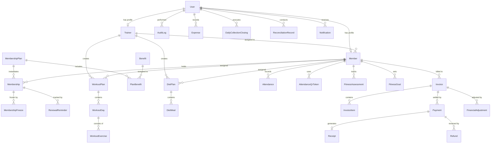

# RV FITNESS — Database Schema Specification

**Engine:** MySQL 8.0+ / MariaDB 10.4+  
**Storage Engine:** InnoDB  
**Collation:** `utf8mb4_unicode_ci`  
**Monetary Representation:** `BigInt` (Minor units in Paisa, ₹1.00 = 100 paisa)  

---

## 1. Entity-Relationship Overview

---

## 2. Core Relational Entities

### 2.1 Identity & Access Control

#### Table: `users`
| Column | Type | Constraints | Description |
| :--- | :--- | :--- | :--- |
| `id` | `VARCHAR(36)` | PK, UUID | Unique user identifier |
| `email` | `VARCHAR(255)` | UNIQUE, NOT NULL | Account email for authentication |
| `password_hash` | `VARCHAR(255)` | NOT NULL | bcrypt hash with work factor 12 |
| `full_name` | `VARCHAR(255)` | NOT NULL | Full name of the user |
| `phone` | `VARCHAR(20)` | NULL | Mobile contact number |
| `role` | `ENUM('ADMIN', 'TRAINER', 'MEMBER')` | NOT NULL, DEFAULT 'MEMBER' | Backend enforced authorization role |
| `is_active` | `BOOLEAN` | NOT NULL, DEFAULT TRUE | Account operational status |
| `last_login_at` | `DATETIME` | NULL | Last successful session timestamp |
| `created_at` | `DATETIME` | NOT NULL, DEFAULT NOW() | Record creation timestamp |
| `updated_at` | `DATETIME` | NOT NULL | Auto-updated timestamp |

*Indexes:* `idx_users_email (email)`, `idx_users_role (role)`

---

### 2.2 Member & Trainer Profiles

#### Table: `members`
| Column | Type | Constraints | Description |
| :--- | :--- | :--- | :--- |
| `id` | `VARCHAR(36)` | PK, UUID | Unique member record identifier |
| `user_id` | `VARCHAR(36)` | UNIQUE, FK -> `users(id)` ON DELETE CASCADE | Linked user credentials |
| `member_code` | `VARCHAR(20)` | UNIQUE, NOT NULL | Gym code (e.g., `RV-2026-0001`) |
| `trainer_id` | `VARCHAR(36)` | NULL, FK -> `trainers(id)` ON DELETE SET NULL | Assigned personal fitness trainer |
| `date_of_birth` | `DATE` | NULL | Member date of birth |
| `gender` | `ENUM('MALE', 'FEMALE', 'OTHER')`| NULL | Member gender |
| `address` | `TEXT` | NULL | Residential address |
| `emergency_contact` | `VARCHAR(20)` | NULL | Emergency phone number |
| `join_date` | `DATE` | NOT NULL | Official enrollment date |
| `photo_url` | `VARCHAR(500)` | NULL | Avatar/profile photo storage path |
| `notes` | `TEXT` | NULL | Member special instructions or medical notes |
| `onboarding_completed` | `BOOLEAN` | NOT NULL, DEFAULT FALSE | Flag indicating whether first-time onboarding wizard is completed |
| `is_active` | `BOOLEAN` | NOT NULL, DEFAULT TRUE | Membership operational status |
| `created_at` | `DATETIME` | NOT NULL, DEFAULT NOW() | Timestamp |
| `updated_at` | `DATETIME` | NOT NULL | Timestamp |

*Indexes:* `idx_members_user_id (user_id)`, `idx_members_code (member_code)`, `idx_members_trainer (trainer_id)`

#### Table: `trainers`
| Column | Type | Constraints | Description |
| :--- | :--- | :--- | :--- |
| `id` | `VARCHAR(36)` | PK, UUID | Unique trainer identifier |
| `user_id` | `VARCHAR(36)` | UNIQUE, FK -> `users(id)` ON DELETE CASCADE | Linked staff user account |
| `specialization` | `VARCHAR(255)` | NOT NULL | e.g. "Strength & Conditioning, Hypertrophy" |
| `bio` | `TEXT` | NULL | Public professional biography |
| `experience_years` | `INT` | NOT NULL, DEFAULT 0 | Years of professional training experience |
| `certifications` | `TEXT` | NULL | e.g. "K11 Certified, CPR Certified" |
| `photo_url` | `VARCHAR(500)` | NULL | Trainer portrait for public website |
| `rating` | `DECIMAL(3,2)` | DEFAULT 5.00 | Average client feedback rating |
| `is_available` | `BOOLEAN` | NOT NULL, DEFAULT TRUE | Ready for new member assignments |
| `is_published` | `BOOLEAN` | NOT NULL, DEFAULT TRUE | Visible on public website /trainers |
| `display_order` | `INT` | NOT NULL, DEFAULT 0 | Ordering index for public web showcase |
| `created_at` | `DATETIME` | NOT NULL, DEFAULT NOW() | Timestamp |
| `updated_at` | `DATETIME` | NOT NULL | Timestamp |

---

### 2.3 Membership Plans, Benefits & Subscriptions

#### Table: `membership_plans`
| Column | Type | Constraints | Description |
| :--- | :--- | :--- | :--- |
| `id` | `VARCHAR(36)` | PK, UUID | Unique plan identifier |
| `name` | `VARCHAR(100)` | NOT NULL | Plan name (e.g., "Monthly Basic", "Yearly Pro") |
| `slug` | `VARCHAR(100)` | UNIQUE, NOT NULL | URL-friendly slug |
| `description` | `TEXT` | NULL | Full description of facilities covered |
| `duration_days` | `INT` | NOT NULL | Validity in days (30, 180, 365) |
| `price_paisa` | `BIGINT` | NOT NULL | Authoritative standard price in paisa |
| `promotional_price_paisa`| `BIGINT` | NULL | Optional discounted promotional price |
| `promo_start_date` | `DATETIME` | NULL | Promotion start validity |
| `promo_end_date` | `DATETIME` | NULL | Promotion end validity |
| `tax_rate_bps` | `INT` | NOT NULL, DEFAULT 1800 | GST rate in basis points (1800 = 18%) |
| `is_popular` | `BOOLEAN` | NOT NULL, DEFAULT FALSE | Highlight with "Best Value" gold badge |
| `display_order` | `INT` | NOT NULL, DEFAULT 0 | Visual order on public pricing grid |
| `is_active` | `BOOLEAN` | NOT NULL, DEFAULT TRUE | Available for admin creation |
| `is_published` | `BOOLEAN` | NOT NULL, DEFAULT TRUE | Publicly visible on website /memberships |
| `created_at` | `DATETIME` | NOT NULL, DEFAULT NOW() | Timestamp |
| `updated_at` | `DATETIME` | NOT NULL | Timestamp |

#### Table: `benefits`
| Column | Type | Constraints | Description |
| :--- | :--- | :--- | :--- |
| `id` | `VARCHAR(36)` | PK, UUID | Unique benefit identifier |
| `title` | `VARCHAR(255)` | NOT NULL | e.g. "Full Gym Access", "Cardio Platform", "Locker Facility" |
| `description` | `TEXT` | NULL | Explanatory text for public tooltip |
| `icon_name` | `VARCHAR(50)` | DEFAULT 'Check' | Lucide icon identifier |
| `is_active` | `BOOLEAN` | NOT NULL, DEFAULT TRUE | Status |
| `created_at` | `DATETIME` | NOT NULL, DEFAULT NOW() | Timestamp |

#### Table: `plan_benefits`
| Column | Type | Constraints | Description |
| :--- | :--- | :--- | :--- |
| `id` | `VARCHAR(36)` | PK, UUID | Unique junction identifier |
| `plan_id` | `VARCHAR(36)` | FK -> `membership_plans(id)` ON DELETE CASCADE | Parent plan |
| `benefit_id` | `VARCHAR(36)` | FK -> `benefits(id)` ON DELETE CASCADE | Associated benefit |
| `display_order` | `INT` | NOT NULL, DEFAULT 0 | Order within card benefit list |
| `is_included` | `BOOLEAN` | NOT NULL, DEFAULT TRUE | True if included, false if excluded |

*Unique Index:* `uq_plan_benefit (plan_id, benefit_id)`

#### Table: `memberships`
| Column | Type | Constraints | Description |
| :--- | :--- | :--- | :--- |
| `id` | `VARCHAR(36)` | PK, UUID | Unique subscription identifier |
| `member_id` | `VARCHAR(36)` | FK -> `members(id)` ON DELETE CASCADE | Subscribed member |
| `plan_id` | `VARCHAR(36)` | FK -> `membership_plans(id)` | Configured plan reference |
| `plan_snapshot` | `JSON` | NOT NULL | **Historical Snapshot:** Name, price, tax, benefits at enrollment |
| `start_date` | `DATE` | NOT NULL | Membership activation date |
| `end_date` | `DATE` | NOT NULL | Scheduled expiration date |
| `status` | `ENUM('ACTIVE', 'EXPIRED', 'CANCELLED', 'FROZEN')` | NOT NULL, DEFAULT 'ACTIVE' | Subscription status |
| `auto_renew` | `BOOLEAN` | NOT NULL, DEFAULT FALSE | Renewal preference flag |
| `notes` | `TEXT` | NULL | Terms or discount notes |
| `created_at` | `DATETIME` | NOT NULL, DEFAULT NOW() | Timestamp |
| `updated_at` | `DATETIME` | NOT NULL | Timestamp |

#### Table: `membership_freezes`
| Column | Type | Constraints | Description |
| :--- | :--- | :--- | :--- |
| `id` | `VARCHAR(36)` | PK, UUID | Unique freeze record |
| `membership_id` | `VARCHAR(36)` | FK -> `memberships(id)` ON DELETE CASCADE | Target membership |
| `start_date` | `DATE` | NOT NULL | Freeze commencement |
| `end_date` | `DATE` | NOT NULL | Expected resumption |
| `actual_end_date` | `DATE` | NULL | Actual resumption date |
| `reason` | `TEXT` | NOT NULL | Medical, travel, or administrative reason |
| `days_extended` | `INT` | NOT NULL, DEFAULT 0 | Added days pushed to `memberships.end_date` |
| `approved_by` | `VARCHAR(36)` | FK -> `users(id)` | Authorizing administrator |
| `created_at` | `DATETIME` | NOT NULL, DEFAULT NOW() | Timestamp |

---

### 2.4 Attendance & Check-in System

#### Table: `attendances`
| Column | Type | Constraints | Description |
| :--- | :--- | :--- | :--- |
| `id` | `VARCHAR(36)` | PK, UUID | Unique attendance record |
| `member_id` | `VARCHAR(36)` | FK -> `members(id)` ON DELETE CASCADE | Checked-in member |
| `date` | `DATE` | NOT NULL | Visit date |
| `check_in_time` | `DATETIME` | NOT NULL, DEFAULT NOW() | Check-in timestamp |
| `check_out_time`| `DATETIME` | NULL | Check-out timestamp |
| `method` | `ENUM('QR_CODE', 'MANUAL_DESK', 'TRAINER_LOG')` | NOT NULL | Check-in channel |
| `verified_by` | `VARCHAR(36)` | NULL, FK -> `users(id)` | Staff who validated check-in |
| `notes` | `VARCHAR(255)` | NULL | Desk note or temperature check |

*Unique Index:* `uq_member_daily_attendance (member_id, date)` (prevents duplicate daily check-in)

#### Table: `attendance_qr_tokens`
| Column | Type | Constraints | Description |
| :--- | :--- | :--- | :--- |
| `id` | `VARCHAR(36)` | PK, UUID | Unique token entry |
| `member_id` | `VARCHAR(36)` | FK -> `members(id)` ON DELETE CASCADE | Associated member |
| `token` | `VARCHAR(255)` | UNIQUE, NOT NULL | Rotating HMAC cryptographic token string |
| `expires_at` | `DATETIME` | NOT NULL | Short-lived validity threshold |
| `is_revoked` | `BOOLEAN` | NOT NULL, DEFAULT FALSE | Revocation status |
| `created_at` | `DATETIME` | NOT NULL, DEFAULT NOW() | Timestamp |

---

### 2.5 Fitness Plans, Measurements & Progress

#### Table: `fitness_assessments`
| Column | Type | Constraints | Description |
| :--- | :--- | :--- | :--- |
| `id` | `VARCHAR(36)` | PK, UUID | Unique assessment record |
| `member_id` | `VARCHAR(36)` | FK -> `members(id)` ON DELETE CASCADE | Evaluated member |
| `recorded_by` | `VARCHAR(36)` | FK -> `users(id)` | Trainer or admin who took measurements |
| `assessment_date`| `DATE` | NOT NULL | Assessment date |
| `weight_kg` | `DECIMAL(5,2)` | NOT NULL | Body weight in kilograms |
| `height_cm` | `DECIMAL(5,2)` | NOT NULL | Height in centimeters |
| `bmi` | `DECIMAL(4,2)` | NOT NULL | Body Mass Index (Calculated: $kg / m^2$) |
| `body_fat_pct` | `DECIMAL(4,2)` | NULL | Body fat percentage |
| `chest_cm` | `DECIMAL(5,2)` | NULL | Chest circumference |
| `waist_cm` | `DECIMAL(5,2)` | NULL | Waist circumference |
| `arms_cm` | `DECIMAL(5,2)` | NULL | Bicep/arms circumference |
| `thighs_cm` | `DECIMAL(5,2)` | NULL | Thighs circumference |
| `notes` | `TEXT` | NULL | Trainer observations |
| `created_at` | `DATETIME` | NOT NULL, DEFAULT NOW() | Timestamp |

#### Table: `fitness_goals`
| Column | Type | Constraints | Description |
| :--- | :--- | :--- | :--- |
| `id` | `VARCHAR(36)` | PK, UUID | Unique goal record |
| `member_id` | `VARCHAR(36)` | FK -> `members(id)` ON DELETE CASCADE | Member |
| `goal_type` | `ENUM('WEIGHT_LOSS', 'MUSCLE_GAIN', 'STRENGTH', 'ENDURANCE', 'GENERAL_FITNESS')` | NOT NULL | Primary goal objective |
| `target_value` | `VARCHAR(100)` | NULL | e.g. "72 kg", "100 kg Bench Press" |
| `target_date` | `DATE` | NULL | Target milestone date |
| `status` | `ENUM('IN_PROGRESS', 'ACHIEVED', 'ABANDONED')` | NOT NULL, DEFAULT 'IN_PROGRESS' | Goal status |
| `created_at` | `DATETIME` | NOT NULL, DEFAULT NOW() | Timestamp |

#### Table: `workout_plans`
| Column | Type | Constraints | Description |
| :--- | :--- | :--- | :--- |
| `id` | `VARCHAR(36)` | PK, UUID | Unique workout plan |
| `member_id` | `VARCHAR(36)` | FK -> `members(id)` ON DELETE CASCADE | Assigned member |
| `trainer_id` | `VARCHAR(36)` | FK -> `trainers(id)` | Authoring trainer |
| `title` | `VARCHAR(255)` | NOT NULL | Routine name (e.g. "Hypertrophy Push-Pull-Legs") |
| `description` | `TEXT` | NULL | Overview and guidance |
| `start_date` | `DATE` | NOT NULL | Implementation start |
| `end_date` | `DATE` | NULL | Scheduled program review |
| `is_active` | `BOOLEAN` | NOT NULL, DEFAULT TRUE | Active client routine flag |
| `created_at` | `DATETIME` | NOT NULL, DEFAULT NOW() | Timestamp |

#### Table: `workout_days`
| Column | Type | Constraints | Description |
| :--- | :--- | :--- | :--- |
| `id` | `VARCHAR(36)` | PK, UUID | Unique routine day |
| `plan_id` | `VARCHAR(36)` | FK -> `workout_plans(id)` ON DELETE CASCADE | Parent workout program |
| `day_number` | `INT` | NOT NULL | Day of week or cycle index (1-7) |
| `day_title` | `VARCHAR(100)` | NOT NULL | e.g. "Monday — Chest & Triceps" |
| `rest_day` | `BOOLEAN` | NOT NULL, DEFAULT FALSE | Flag for designated recovery day |

#### Table: `workout_exercises`
| Column | Type | Constraints | Description |
| :--- | :--- | :--- | :--- |
| `id` | `VARCHAR(36)` | PK, UUID | Unique exercise item |
| `day_id` | `VARCHAR(36)` | FK -> `workout_days(id)` ON DELETE CASCADE | Parent workout day |
| `exercise_name` | `VARCHAR(255)` | NOT NULL | e.g. "Barbell Incline Bench Press" |
| `sets` | `INT` | NOT NULL | Working set count |
| `reps` | `VARCHAR(50)` | NOT NULL | Repetition target (e.g. "8-12", "Till Failure") |
| `rest_seconds` | `INT` | DEFAULT 90 | Inter-set rest period |
| `order_index` | `INT` | NOT NULL, DEFAULT 0 | Exercise order sequence |
| `target_muscle` | `VARCHAR(100)` | NULL | Primary target muscle group (e.g. "Chest", "Quads", "Lats") |
| `required_equipment` | `VARCHAR(100)` | NULL | Station or machine name required for this exercise |
| `alternative_exercise_name` | `VARCHAR(255)` | NULL | Substitution exercise if required equipment is in maintenance |

#### Table: `equipment`
| Column | Type | Constraints | Description |
| :--- | :--- | :--- | :--- |
| `id` | `VARCHAR(36)` | PK, UUID | Unique gym equipment station identifier |
| `name` | `VARCHAR(255)` | NOT NULL | Equipment station name (e.g. "Pec Deck / Rear Delt Fly Machine") |
| `category` | `VARCHAR(100)` | NOT NULL | Category (e.g. "Strength Machine", "Free Weights", "Cardio") |
| `status` | `ENUM('AVAILABLE', 'IN_USE', 'MAINTENANCE', 'OUT_OF_SERVICE')` | NOT NULL, DEFAULT 'AVAILABLE' | Real-time floor operational status |
| `location` | `VARCHAR(100)` | NULL | Floor zone (e.g. "Zone A - Free Weights", "Zone B - Selectorized") |
| `serial_number` | `VARCHAR(100)` | NULL | Hardware serial number or inventory tag |
| `notes` | `TEXT` | NULL | Maintenance log or operational remarks |
| `created_at` | `DATETIME` | NOT NULL, DEFAULT NOW() | Timestamp |
| `updated_at` | `DATETIME` | NOT NULL | Timestamp |

*Indexes:* `idx_equipment_status (status)`, `idx_equipment_category (category)`

#### Table: `diet_plans`
| Column | Type | Constraints | Description |
| :--- | :--- | :--- | :--- |
| `id` | `VARCHAR(36)` | PK, UUID | Unique nutrition plan |
| `member_id` | `VARCHAR(36)` | FK -> `members(id)` ON DELETE CASCADE | Assigned member |
| `trainer_id` | `VARCHAR(36)` | FK -> `trainers(id)` | Authoring fitness consultant |
| `title` | `VARCHAR(255)` | NOT NULL | e.g. "High Protein Lean Bulking Diet" |
| `daily_calories` | `INT` | NOT NULL | Target caloric intake |
| `protein_grams` | `INT` | NOT NULL | Daily protein target |
| `carbs_grams` | `INT` | NOT NULL | Daily carbohydrates target |
| `fats_grams` | `INT` | NOT NULL | Daily healthy fats target |
| `guidelines` | `TEXT` | NULL | Hydration, supplement, and timing notes |
| `is_active` | `BOOLEAN` | NOT NULL, DEFAULT TRUE | Active status |
| `created_at` | `DATETIME` | NOT NULL, DEFAULT NOW() | Timestamp |

#### Table: `diet_meals`
| Column | Type | Constraints | Description |
| :--- | :--- | :--- | :--- |
| `id` | `VARCHAR(36)` | PK, UUID | Unique meal item |
| `diet_plan_id` | `VARCHAR(36)` | FK -> `diet_plans(id)` ON DELETE CASCADE | Parent diet plan |
| `meal_name` | `VARCHAR(100)` | NOT NULL | e.g. "Breakfast (8:30 AM)", "Post-Workout" |
| `food_items` | `TEXT` | NOT NULL | Detailed food descriptions and gram portions |
| `calories` | `INT` | NULL | Estimated meal calories |
| `order_index` | `INT` | NOT NULL, DEFAULT 0 | Sequence of meal |

---

### 2.6 Financial Entities (Invoices, Payments, Receipts, Refunds, Expenses)

#### Table: `invoices`
| Column | Type | Constraints | Description |
| :--- | :--- | :--- | :--- |
| `id` | `VARCHAR(36)` | PK, UUID | Unique invoice identifier |
| `invoice_number` | `VARCHAR(30)` | UNIQUE, NOT NULL | Sequential number (e.g. `RV-INV-2026-0001`) |
| `member_id` | `VARCHAR(36)` | FK -> `members(id)` ON DELETE RESTRICT | Billed member |
| `status` | `ENUM('DRAFT', 'ISSUED', 'PARTIALLY_PAID', 'PAID', 'OVERDUE', 'CANCELLED', 'VOID')` | NOT NULL, DEFAULT 'DRAFT' | Invoice lifecycle status |
| `subtotal_paisa` | `BIGINT` | NOT NULL | Base subtotal in paisa |
| `tax_paisa` | `BIGINT` | NOT NULL, DEFAULT 0 | Applied GST in paisa |
| `discount_paisa` | `BIGINT` | NOT NULL, DEFAULT 0 | Discount deducted in paisa |
| `total_paisa` | `BIGINT` | NOT NULL | Net payable total in paisa |
| `paid_paisa` | `BIGINT` | NOT NULL, DEFAULT 0 | Total verified collections in paisa |
| `due_date` | `DATE` | NOT NULL | Payment deadline |
| `issued_at` | `DATETIME` | NULL | Formal issue timestamp |
| `notes` | `TEXT` | NULL | Customer notes (prints on invoice) |
| `internal_notes`| `TEXT` | NULL | Confidential administrative notes |
| `created_by` | `VARCHAR(36)` | FK -> `users(id)` | Staff member who created invoice |
| `created_at` | `DATETIME` | NOT NULL, DEFAULT NOW() | Timestamp |
| `updated_at` | `DATETIME` | NOT NULL | Timestamp |

#### Table: `invoice_items`
| Column | Type | Constraints | Description |
| :--- | :--- | :--- | :--- |
| `id` | `VARCHAR(36)` | PK, UUID | Unique item identifier |
| `invoice_id` | `VARCHAR(36)` | FK -> `invoices(id)` ON DELETE CASCADE | Parent invoice |
| `membership_id`| `VARCHAR(36)` | NULL, FK -> `memberships(id)` | Linked subscription |
| `description` | `VARCHAR(255)` | NOT NULL | Description (e.g. "Yearly Pro Membership (12 Months)") |
| `quantity` | `INT` | NOT NULL, DEFAULT 1 | Item quantity |
| `unit_price_paisa`| `BIGINT` | NOT NULL | **Snapshotted** unit price |
| `tax_rate_bps` | `INT` | NOT NULL, DEFAULT 1800 | GST rate in bps (18%) |
| `tax_paisa` | `BIGINT` | NOT NULL, DEFAULT 0 | Computed GST |
| `discount_paisa`| `BIGINT` | NOT NULL, DEFAULT 0 | Item discount |
| `total_paisa` | `BIGINT` | NOT NULL | Total item charge |

#### Table: `payments`
| Column | Type | Constraints | Description |
| :--- | :--- | :--- | :--- |
| `id` | `VARCHAR(36)` | PK, UUID | Unique payment identifier |
| `payment_number`| `VARCHAR(30)` | UNIQUE, NOT NULL | Sequential number (e.g. `RV-PAY-2026-0001`) |
| `invoice_id` | `VARCHAR(36)` | FK -> `invoices(id)` | Target invoice |
| `member_id` | `VARCHAR(36)` | FK -> `members(id)` | Payer member |
| `amount_paisa` | `BIGINT` | NOT NULL | Collected settlement in paisa |
| `method` | `ENUM('CASH', 'UPI', 'BANK_TRANSFER', 'CARD', 'OTHER')` | NOT NULL | Payment channel |
| `status` | `ENUM('PENDING', 'CONFIRMED', 'FAILED', 'REVERSED')` | NOT NULL, DEFAULT 'CONFIRMED' | Payment status |
| `reference_number`| `VARCHAR(100)` | NULL | Bank transaction UTR or card auth code |
| `idempotency_key`| `VARCHAR(255)` | UNIQUE, NULL | Deduplication key |
| `payment_date` | `DATETIME` | NOT NULL, DEFAULT NOW() | Transaction date |
| `notes` | `TEXT` | NULL | Staff counter memo |
| `recorded_by` | `VARCHAR(36)` | FK -> `users(id)` | Cashier / admin user |
| `confirmed_at` | `DATETIME` | NULL | Confirmation timestamp |

#### Table: `receipts`
| Column | Type | Constraints | Description |
| :--- | :--- | :--- | :--- |
| `id` | `VARCHAR(36)` | PK, UUID | Unique receipt identifier |
| `receipt_number`| `VARCHAR(30)` | UNIQUE, NOT NULL | Sequential voucher number (`RV-REC-2026-0001`) |
| `payment_id` | `VARCHAR(36)` | UNIQUE, FK -> `payments(id)` | Linked payment record |
| `invoice_id` | `VARCHAR(36)` | FK -> `invoices(id)` | Linked tax invoice |
| `member_id` | `VARCHAR(36)` | FK -> `members(id)` | Payer member |
| `amount_paisa` | `BIGINT` | NOT NULL | Total confirmed amount in paisa |
| `issued_at` | `DATETIME` | NOT NULL, DEFAULT NOW() | Receipt generation timestamp |
| `issued_by` | `VARCHAR(36)` | FK -> `users(id)` | Cashier / issuer |
| `pdf_path` | `VARCHAR(500)` | NULL | Cached PDF storage path |

#### Table: `refunds`
| Column | Type | Constraints | Description |
| :--- | :--- | :--- | :--- |
| `id` | `VARCHAR(36)` | PK, UUID | Unique refund identifier |
| `refund_number` | `VARCHAR(30)` | UNIQUE, NOT NULL | Sequential number (`RV-REF-2026-0001`) |
| `payment_id` | `VARCHAR(36)` | FK -> `payments(id)` | Original payment |
| `invoice_id` | `VARCHAR(36)` | FK -> `invoices(id)` | Associated invoice |
| `member_id` | `VARCHAR(36)` | FK -> `members(id)` | Member receiving refund |
| `amount_paisa` | `BIGINT` | NOT NULL | Refunded sum in paisa |
| `reason` | `TEXT` | NOT NULL | Mandatory audit rationale |
| `status` | `ENUM('REQUESTED', 'APPROVED', 'PROCESSED', 'REJECTED')` | NOT NULL, DEFAULT 'REQUESTED' | Two-step approval status |
| `method` | `ENUM('CASH', 'UPI', 'BANK_TRANSFER', 'CARD', 'ORIGINAL_METHOD', 'OTHER')` | NOT NULL | Disbursement channel |
| `reference_number`| `VARCHAR(100)`| NULL | Reversal transaction UTR |
| `requested_by` | `VARCHAR(36)` | FK -> `users(id)` | Initiating staff |
| `processed_by` | `VARCHAR(36)` | NULL, FK -> `users(id)` | Authorizing administrator |
| `processed_at` | `DATETIME` | NULL | Disbursal timestamp |

#### Table: `expenses`
| Column | Type | Constraints | Description |
| :--- | :--- | :--- | :--- |
| `id` | `VARCHAR(36)` | PK, UUID | Unique expense identifier |
| `expense_number`| `VARCHAR(30)` | UNIQUE, NOT NULL | Sequential voucher (`RV-EXP-2026-0001`) |
| `category` | `ENUM('RENT', 'ELECTRICITY', 'SALARY', 'EQUIPMENT_MAINTENANCE', 'CLEANING', 'MARKETING', 'SUPPLIES', 'OTHER')` | NOT NULL | Operational cost classification |
| `title` | `VARCHAR(255)` | NOT NULL | Brief summary (e.g., "Monthly Facility Rent - October") |
| `description` | `TEXT` | NULL | Full payment justification |
| `amount_paisa` | `BIGINT` | NOT NULL | Disbursed amount in paisa |
| `expense_date` | `DATE` | NOT NULL | Expense accounting date |
| `payment_method`| `VARCHAR(50)` | NOT NULL, DEFAULT 'BANK_TRANSFER' | Cash, Cheque, Bank Transfer, UPI |
| `reference_number`| `VARCHAR(100)`| NULL | Payment UTR or bill receipt number |
| `recorded_by` | `VARCHAR(36)` | FK -> `users(id)` | Accounting staff user |
| `created_at` | `DATETIME` | NOT NULL, DEFAULT NOW() | Timestamp |

---

### 2.7 CMS, Communication & Audit

#### Table: `gym_events`
| Column | Type | Constraints | Description |
| :--- | :--- | :--- | :--- |
| `id` | `VARCHAR(36)` | PK, UUID | Unique event identifier |
| `title` | `VARCHAR(255)` | NOT NULL | Event name (e.g., "Narsobawadi Bench Press Championship") |
| `slug` | `VARCHAR(255)` | UNIQUE, NOT NULL | URL-friendly identifier |
| `description` | `TEXT` | NOT NULL | Detailed event agenda and rules |
| `event_date` | `DATETIME` | NOT NULL | Scheduled event timestamp |
| `location` | `VARCHAR(255)` | NOT NULL, DEFAULT 'RV Fitness Main Hall' | Venue |
| `banner_url` | `VARCHAR(500)` | NULL | Banner artwork |
| `is_published` | `BOOLEAN` | NOT NULL, DEFAULT TRUE | Public visibility toggle |
| `created_at` | `DATETIME` | NOT NULL, DEFAULT NOW() | Timestamp |

#### Table: `gallery_posts`
| Column | Type | Constraints | Description |
| :--- | :--- | :--- | :--- |
| `id` | `VARCHAR(36)` | PK, UUID | Unique gallery post |
| `title` | `VARCHAR(255)` | NOT NULL | Image title |
| `category` | `ENUM('EQUIPMENT', 'FACILITY', 'TRANSFORMATION', 'COMMUNITY')` | NOT NULL | Filter category |
| `image_url` | `VARCHAR(500)` | NOT NULL | Web-optimized asset URL |
| `caption` | `TEXT` | NULL | Optional caption |
| `display_order` | `INT` | NOT NULL, DEFAULT 0 | Presentation order |
| `is_published` | `BOOLEAN` | NOT NULL, DEFAULT TRUE | Visibility flag |
| `created_at` | `DATETIME` | NOT NULL, DEFAULT NOW() | Timestamp |

#### Table: `offers_coupons`
| Column | Type | Constraints | Description |
| :--- | :--- | :--- | :--- |
| `id` | `VARCHAR(36)` | PK, UUID | Unique offer record |
| `code` | `VARCHAR(50)` | UNIQUE, NOT NULL | Promo code (e.g. `DIWALI2026`) |
| `title` | `VARCHAR(255)` | NOT NULL | Deal title |
| `discount_type` | `ENUM('PERCENTAGE', 'FIXED_AMOUNT')` | NOT NULL | Discount mode |
| `discount_value`| `INT` | NOT NULL | Percentage (e.g. 15 = 15%) or fixed paisa |
| `valid_from` | `DATETIME` | NOT NULL | Promotion start |
| `valid_to` | `DATETIME` | NOT NULL | Promotion expiry |
| `usage_limit` | `INT` | NULL | Maximum allowed redemptions |
| `used_count` | `INT` | NOT NULL, DEFAULT 0 | Redemptions count |
| `is_active` | `BOOLEAN` | NOT NULL, DEFAULT TRUE | Active status |

#### Table: `contact_inquiries`
| Column | Type | Constraints | Description |
| :--- | :--- | :--- | :--- |
| `id` | `VARCHAR(36)` | PK, UUID | Unique inquiry |
| `full_name` | `VARCHAR(255)` | NOT NULL | Lead name |
| `email` | `VARCHAR(255)` | NOT NULL | Contact email |
| `phone` | `VARCHAR(20)` | NOT NULL | Mobile number |
| `subject` | `VARCHAR(255)` | NOT NULL | Message subject |
| `message` | `TEXT` | NOT NULL | Visitor inquiry |
| `status` | `ENUM('NEW', 'READ', 'RESPONDED')` | NOT NULL, DEFAULT 'NEW' | Lead triage status |
| `created_at` | `DATETIME` | NOT NULL, DEFAULT NOW() | Timestamp |

#### Table: `notifications`
| Column | Type | Constraints | Description |
| :--- | :--- | :--- | :--- |
| `id` | `VARCHAR(36)` | PK, UUID | Unique notification |
| `title` | `VARCHAR(255)` | NOT NULL | Alert title |
| `message` | `TEXT` | NOT NULL | Body message |
| `type` | `ENUM('GENERAL', 'EXPIRY_WARNING', 'PAYMENT_REMINDER', 'WORKOUT_ASSIGNED', 'DIET_ASSIGNED', 'ANNOUNCEMENT')` | NOT NULL | Category |
| `target_type` | `ENUM('ALL', 'EXPIRING_MEMBERS', 'UNPAID_MEMBERS', 'TRAINER_MEMBERS', 'SPECIFIC_USER')` | NOT NULL | Broadcast audience |
| `target_user_id`| `VARCHAR(36)` | NULL, FK -> `users(id)` | Specific recipient if applicable |
| `is_read` | `BOOLEAN` | NOT NULL, DEFAULT FALSE | Read indicator |
| `created_at` | `DATETIME` | NOT NULL, DEFAULT NOW() | Timestamp |

#### Table: `audit_logs`
| Column | Type | Constraints | Description |
| :--- | :--- | :--- | :--- |
| `id` | `VARCHAR(36)` | PK, UUID | Unique audit entry |
| `user_id` | `VARCHAR(36)` | FK -> `users(id)` | Acting operator |
| `action` | `VARCHAR(100)` | NOT NULL | e.g. `INVOICE_CREATED`, `PAYMENT_REVERSED` |
| `entity_type` | `VARCHAR(100)` | NOT NULL | Entity domain (`Invoice`, `Payment`, `Membership`) |
| `entity_id` | `VARCHAR(36)` | NOT NULL | Primary key of affected record |
| `old_values` | `JSON` | NULL | Pre-mutation snapshot |
| `new_values` | `JSON` | NULL | Post-mutation snapshot |
| `ip_address` | `VARCHAR(45)` | NULL | Client IP address |
| `user_agent` | `VARCHAR(255)` | NULL | Client browser string |
| `created_at` | `DATETIME` | NOT NULL, DEFAULT NOW() | Immutable timestamp |
