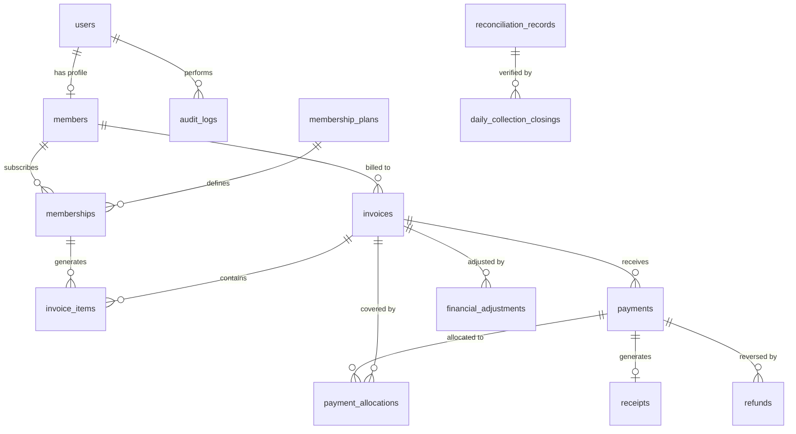

# RV Fitness — Database Schema (MySQL 8.0+ / MariaDB Edition)

## Overview

All monetary values are stored as **integers in paisa** (`BIGINT`, where 1 INR = 100 paisa) to avoid floating-point errors.
All timestamps use `DATETIME(3)` (UTC). All tables include `created_at` and `updated_at`.
Primary keys and foreign keys for entity IDs use `VARCHAR(36)` (RFC 4122 UUID strings).
Database engine: **InnoDB** across all tables, ensuring ACID transactions, foreign key constraints, row-level locking, and crash recovery.
Character Set: `utf8mb4`, Collation: `utf8mb4_unicode_ci`.

---

## Entity Relationship Diagram

---

## Tables

### 1. users
Core user account for authentication and authorization.

| Column | Type | Constraints | Description |
|--------|------|-------------|-------------|
| id | VARCHAR(36) | PK | Unique identifier (UUIDv4) |
| email | VARCHAR(255) | UNIQUE, NOT NULL | Login email |
| password_hash | VARCHAR(255) | NOT NULL | bcrypt hash (12 rounds) |
| full_name | VARCHAR(255) | NOT NULL | Display name |
| phone | VARCHAR(20) | NULLABLE | Phone number |
| role | ENUM('ADMIN','MEMBER','TRAINER') | NOT NULL, DEFAULT 'MEMBER' | Access role |
| is_active | BOOLEAN | NOT NULL, DEFAULT true | Account status |
| last_login_at | DATETIME(3) | NULLABLE | Last login timestamp |
| created_at | DATETIME(3) | NOT NULL, DEFAULT CURRENT_TIMESTAMP(3) | Creation time |
| updated_at | DATETIME(3) | NOT NULL, DEFAULT CURRENT_TIMESTAMP(3) | Last update time |

**Indexes:** `email` (unique), `role`

---

### 2. members
Extended profile for gym members. Owned by Members module.

| Column | Type | Constraints | Description |
|--------|------|-------------|-------------|
| id | VARCHAR(36) | PK | Member ID |
| user_id | VARCHAR(36) | FK → users.id, UNIQUE, NOT NULL | Linked user account |
| member_code | VARCHAR(20) | UNIQUE, NOT NULL | Human-readable member code (e.g., RVF-0001) |
| date_of_birth | DATE | NULLABLE | Date of birth |
| gender | ENUM('MALE','FEMALE','OTHER') | NULLABLE | Gender |
| address | TEXT | NULLABLE | Address |
| emergency_contact | VARCHAR(20) | NULLABLE | Emergency phone |
| join_date | DATE | NOT NULL | Gym join date |
| photo_url | VARCHAR(500) | NULLABLE | Profile photo URL |
| notes | TEXT | NULLABLE | Admin notes |
| is_active | BOOLEAN | NOT NULL, DEFAULT true | Membership active |
| created_at | DATETIME(3) | NOT NULL, DEFAULT CURRENT_TIMESTAMP(3) | |
| updated_at | DATETIME(3) | NOT NULL, DEFAULT CURRENT_TIMESTAMP(3) | |

**Indexes:** `user_id` (unique), `member_code` (unique), `is_active`

---

### 3. membership_plans
Defines available plans. Owned by Memberships module.

| Column | Type | Constraints | Description |
|--------|------|-------------|-------------|
| id | VARCHAR(36) | PK | Plan ID |
| name | VARCHAR(100) | NOT NULL | Plan name (e.g., "Annual Gold") |
| description | TEXT | NULLABLE | Plan description |
| duration_days | INT | NOT NULL | Duration in days |
| price_paisa | BIGINT | NOT NULL | Price in paisa |
| tax_rate_bps | INT | NOT NULL, DEFAULT 0 | Tax rate in basis points (e.g., 1800 = 18%) |
| is_active | BOOLEAN | NOT NULL, DEFAULT true | Plan availability |
| created_at | DATETIME(3) | NOT NULL, DEFAULT CURRENT_TIMESTAMP(3) | |
| updated_at | DATETIME(3) | NOT NULL, DEFAULT CURRENT_TIMESTAMP(3) | |

**Indexes:** `is_active`

---

### 4. memberships
A member's subscription to a plan. Owned by Memberships module.

| Column | Type | Constraints | Description |
|--------|------|-------------|-------------|
| id | VARCHAR(36) | PK | Membership ID |
| member_id | VARCHAR(36) | FK → members.id, NOT NULL | Member |
| plan_id | VARCHAR(36) | FK → membership_plans.id, NOT NULL | Selected plan |
| start_date | DATE | NOT NULL | Subscription start |
| end_date | DATE | NOT NULL | Subscription end |
| status | ENUM('ACTIVE','EXPIRED','CANCELLED','FROZEN') | NOT NULL, DEFAULT 'ACTIVE' | |
| created_at | DATETIME(3) | NOT NULL, DEFAULT CURRENT_TIMESTAMP(3) | |
| updated_at | DATETIME(3) | NOT NULL, DEFAULT CURRENT_TIMESTAMP(3) | |

**Indexes:** `member_id`, `status`, `end_date`

---

### 5. invoices
Financial invoice for a member. Owned by Billing module.

| Column | Type | Constraints | Description |
|--------|------|-------------|-------------|
| id | VARCHAR(36) | PK | Invoice ID |
| invoice_number | VARCHAR(30) | UNIQUE, NOT NULL | Human-readable (e.g., INV-2026-0001) |
| member_id | VARCHAR(36) | FK → members.id, NOT NULL | Billed member |
| status | ENUM('DRAFT','ISSUED','PARTIALLY_PAID','PAID','OVERDUE','CANCELLED','VOID') | NOT NULL, DEFAULT 'DRAFT' | |
| subtotal_paisa | BIGINT | NOT NULL | Sum of line items before tax |
| tax_paisa | BIGINT | NOT NULL, DEFAULT 0 | Total tax amount |
| discount_paisa | BIGINT | NOT NULL, DEFAULT 0 | Total discount |
| total_paisa | BIGINT | NOT NULL | Final total (subtotal + tax - discount) |
| paid_paisa | BIGINT | NOT NULL, DEFAULT 0 | Amount paid so far |
| due_date | DATE | NOT NULL | Payment due date |
| issued_at | DATETIME(3) | NULLABLE | When invoice was issued |
| notes | TEXT | NULLABLE | Notes for member |
| internal_notes | TEXT | NULLABLE | Admin-only notes |
| created_by | VARCHAR(36) | FK → users.id, NOT NULL | Admin who created |
| created_at | DATETIME(3) | NOT NULL, DEFAULT CURRENT_TIMESTAMP(3) | |
| updated_at | DATETIME(3) | NOT NULL, DEFAULT CURRENT_TIMESTAMP(3) | |

**Indexes:** `invoice_number` (unique), `member_id`, `status`, `due_date`, `created_at`

---

### 6. invoice_items
Line items on an invoice. Snapshots prices at creation time.

| Column | Type | Constraints | Description |
|--------|------|-------------|-------------|
| id | VARCHAR(36) | PK | Item ID |
| invoice_id | VARCHAR(36) | FK → invoices.id, NOT NULL, ON DELETE CASCADE | Parent invoice |
| membership_id | VARCHAR(36) | FK → memberships.id, NULLABLE | Linked membership |
| description | VARCHAR(255) | NOT NULL | Item description |
| quantity | INT | NOT NULL, DEFAULT 1 | Quantity |
| unit_price_paisa | BIGINT | NOT NULL | Snapshotted unit price |
| tax_rate_bps | INT | NOT NULL, DEFAULT 0 | Snapshotted tax rate |
| tax_paisa | BIGINT | NOT NULL, DEFAULT 0 | Calculated tax |
| discount_paisa | BIGINT | NOT NULL, DEFAULT 0 | Item discount |
| total_paisa | BIGINT | NOT NULL | (qty × unit_price + tax - discount) |
| created_at | DATETIME(3) | NOT NULL, DEFAULT CURRENT_TIMESTAMP(3) | |

**Indexes:** `invoice_id`, `membership_id`

---

### 7. payments
Records of payments received.

| Column | Type | Constraints | Description |
|--------|------|-------------|-------------|
| id | VARCHAR(36) | PK | Payment ID |
| payment_number | VARCHAR(30) | UNIQUE, NOT NULL | Human-readable (e.g., PAY-2026-0001) |
| invoice_id | VARCHAR(36) | FK → invoices.id, NOT NULL | Associated invoice |
| member_id | VARCHAR(36) | FK → members.id, NOT NULL | Paying member |
| amount_paisa | BIGINT | NOT NULL | Payment amount |
| method | ENUM('CASH','UPI','BANK_TRANSFER','CARD','OTHER') | NOT NULL | Payment method |
| status | ENUM('PENDING','CONFIRMED','FAILED','REVERSED') | NOT NULL, DEFAULT 'PENDING' | |
| reference_number | VARCHAR(100) | NULLABLE | External reference (UPI txn ID, etc.) |
| idempotency_key | VARCHAR(100) | UNIQUE, NULLABLE | Prevents duplicate submissions |
| payment_date | DATE | NOT NULL | Date payment was made |
| notes | TEXT | NULLABLE | Payment notes |
| recorded_by | VARCHAR(36) | FK → users.id, NOT NULL | Admin who recorded |
| confirmed_at | DATETIME(3) | NULLABLE | Confirmation timestamp |
| created_at | DATETIME(3) | NOT NULL, DEFAULT CURRENT_TIMESTAMP(3) | |
| updated_at | DATETIME(3) | NOT NULL, DEFAULT CURRENT_TIMESTAMP(3) | |

**Indexes:** `payment_number` (unique), `invoice_id`, `member_id`, `status`, `method`, `reference_number`, `idempotency_key` (unique), `payment_date`

---

### 8. payment_allocations
Maps payments to invoices when a payment covers multiple invoices or partial amounts.

| Column | Type | Constraints | Description |
|--------|------|-------------|-------------|
| id | VARCHAR(36) | PK | Allocation ID |
| payment_id | VARCHAR(36) | FK → payments.id, NOT NULL | Source payment |
| invoice_id | VARCHAR(36) | FK → invoices.id, NOT NULL | Target invoice |
| amount_paisa | BIGINT | NOT NULL | Amount allocated |
| created_at | DATETIME(3) | NOT NULL, DEFAULT CURRENT_TIMESTAMP(3) | |

**Indexes:** `payment_id`, `invoice_id`
**Unique constraint:** `(payment_id, invoice_id)`

---

### 9. receipts
Immutable receipt for a confirmed payment.

| Column | Type | Constraints | Description |
|--------|------|-------------|-------------|
| id | VARCHAR(36) | PK | Receipt ID |
| receipt_number | VARCHAR(30) | UNIQUE, NOT NULL | Human-readable (e.g., RCT-2026-0001) |
| payment_id | VARCHAR(36) | FK → payments.id, UNIQUE, NOT NULL | Source payment |
| invoice_id | VARCHAR(36) | FK → invoices.id, NOT NULL | Related invoice |
| member_id | VARCHAR(36) | FK → members.id, NOT NULL | Member |
| amount_paisa | BIGINT | NOT NULL | Receipt amount |
| issued_at | DATETIME(3) | NOT NULL, DEFAULT CURRENT_TIMESTAMP(3) | Issue timestamp |
| issued_by | VARCHAR(36) | FK → users.id, NOT NULL | Issuing admin |
| pdf_path | VARCHAR(500) | NULLABLE | Stored PDF path |
| created_at | DATETIME(3) | NOT NULL, DEFAULT CURRENT_TIMESTAMP(3) | |

**Indexes:** `receipt_number` (unique), `payment_id` (unique), `member_id`, `issued_at`

---

### 10. refunds
Auditable refund records linked to original payments.

| Column | Type | Constraints | Description |
|--------|------|-------------|-------------|
| id | VARCHAR(36) | PK | Refund ID |
| refund_number | VARCHAR(30) | UNIQUE, NOT NULL | Human-readable (e.g., REF-2026-0001) |
| payment_id | VARCHAR(36) | FK → payments.id, NOT NULL | Original payment |
| invoice_id | VARCHAR(36) | FK → invoices.id, NOT NULL | Related invoice |
| member_id | VARCHAR(36) | FK → members.id, NOT NULL | Member |
| amount_paisa | BIGINT | NOT NULL | Refund amount |
| reason | TEXT | NOT NULL | Reason for refund |
| status | ENUM('REQUESTED','APPROVED','PROCESSED','REJECTED') | NOT NULL, DEFAULT 'REQUESTED' | |
| method | ENUM('CASH','UPI','BANK_TRANSFER','CARD','ORIGINAL_METHOD','OTHER') | NOT NULL | Refund method |
| reference_number | VARCHAR(100) | NULLABLE | Refund reference |
| processed_by | VARCHAR(36) | FK → users.id, NULLABLE | Admin who processed |
| processed_at | DATETIME(3) | NULLABLE | Processing timestamp |
| requested_by | VARCHAR(36) | FK → users.id, NOT NULL | Admin who requested |
| created_at | DATETIME(3) | NOT NULL, DEFAULT CURRENT_TIMESTAMP(3) | |
| updated_at | DATETIME(3) | NOT NULL, DEFAULT CURRENT_TIMESTAMP(3) | |

**Indexes:** `refund_number` (unique), `payment_id`, `invoice_id`, `member_id`, `status`

---

### 11. financial_adjustments
Controlled corrections and reversals that preserve history.

| Column | Type | Constraints | Description |
|--------|------|-------------|-------------|
| id | VARCHAR(36) | PK | Adjustment ID |
| adjustment_number | VARCHAR(30) | UNIQUE, NOT NULL | Human-readable (e.g., ADJ-2026-0001) |
| invoice_id | VARCHAR(36) | FK → invoices.id, NOT NULL | Related invoice |
| type | ENUM('CREDIT','DEBIT','WRITE_OFF','CORRECTION') | NOT NULL | Adjustment type |
| amount_paisa | BIGINT | NOT NULL | Adjustment amount |
| reason | TEXT | NOT NULL | Explanation |
| performed_by | VARCHAR(36) | FK → users.id, NOT NULL | Admin |
| created_at | DATETIME(3) | NOT NULL, DEFAULT CURRENT_TIMESTAMP(3) | |

**Indexes:** `invoice_id`, `type`, `created_at`

---

### 12. audit_logs
Complete trail of all financial operations.

| Column | Type | Constraints | Description |
|--------|------|-------------|-------------|
| id | VARCHAR(36) | PK | Log ID |
| user_id | VARCHAR(36) | FK → users.id, NOT NULL | Actor |
| action | VARCHAR(100) | NOT NULL | Action performed |
| entity_type | VARCHAR(50) | NOT NULL | Entity type (invoice, payment, etc.) |
| entity_id | VARCHAR(36) | NOT NULL | Entity ID |
| old_values | JSON | NULLABLE | Previous state |
| new_values | JSON | NULLABLE | New state |
| ip_address | VARCHAR(45) | NULLABLE | Client IP |
| user_agent | VARCHAR(500) | NULLABLE | Client user agent |
| created_at | DATETIME(3) | NOT NULL, DEFAULT CURRENT_TIMESTAMP(3) | |

**Indexes:** `user_id`, `entity_type + entity_id`, `action`, `created_at`

---

### 13. reconciliation_records
Compares recorded totals with declared amounts.

| Column | Type | Constraints | Description |
|--------|------|-------------|-------------|
| id | VARCHAR(36) | PK | Record ID |
| reconciliation_date | DATE | NOT NULL | Date being reconciled |
| period_start | DATETIME(3) | NOT NULL | Period start |
| period_end | DATETIME(3) | NOT NULL | Period end |
| recorded_cash_paisa | BIGINT | NOT NULL, DEFAULT 0 | System-recorded cash |
| recorded_upi_paisa | BIGINT | NOT NULL, DEFAULT 0 | System-recorded UPI |
| recorded_card_paisa | BIGINT | NOT NULL, DEFAULT 0 | System-recorded card |
| recorded_bank_paisa | BIGINT | NOT NULL, DEFAULT 0 | System-recorded bank |
| recorded_other_paisa | BIGINT | NOT NULL, DEFAULT 0 | System-recorded other |
| recorded_total_paisa | BIGINT | NOT NULL | Total system-recorded |
| declared_cash_paisa | BIGINT | NULLABLE | Declared cash on hand |
| declared_digital_paisa | BIGINT | NULLABLE | Declared digital total |
| declared_total_paisa | BIGINT | NULLABLE | Total declared |
| discrepancy_paisa | BIGINT | NULLABLE | Difference |
| status | ENUM('PENDING','MATCHED','DISCREPANCY','RESOLVED') | NOT NULL, DEFAULT 'PENDING' | |
| notes | TEXT | NULLABLE | |
| performed_by | VARCHAR(36) | FK → users.id, NOT NULL | |
| created_at | DATETIME(3) | NOT NULL, DEFAULT CURRENT_TIMESTAMP(3) | |
| updated_at | DATETIME(3) | NOT NULL, DEFAULT CURRENT_TIMESTAMP(3) | |

**Indexes:** `reconciliation_date`, `status`

---

### 14. daily_collection_closings
End-of-day cash and digital collection closing records.

| Column | Type | Constraints | Description |
|--------|------|-------------|-------------|
| id | VARCHAR(36) | PK | Closing ID |
| closing_date | DATE | UNIQUE, NOT NULL | Business date |
| reconciliation_id | VARCHAR(36) | FK → reconciliation_records.id, NULLABLE | Linked reconciliation |
| total_collections_paisa | BIGINT | NOT NULL | Total collections |
| cash_collections_paisa | BIGINT | NOT NULL, DEFAULT 0 | Cash portion |
| digital_collections_paisa | BIGINT | NOT NULL, DEFAULT 0 | Digital portion |
| invoices_issued | INT | NOT NULL, DEFAULT 0 | Invoices created today |
| invoices_paid | INT | NOT NULL, DEFAULT 0 | Invoices fully paid |
| refunds_processed_paisa | BIGINT | NOT NULL, DEFAULT 0 | Total refunds |
| declared_cash_paisa | BIGINT | NULLABLE | Admin-declared cash |
| declared_digital_paisa | BIGINT | NULLABLE | Admin-declared digital |
| discrepancy_paisa | BIGINT | NULLABLE | Variance |
| status | ENUM('OPEN','CLOSED','VERIFIED') | NOT NULL, DEFAULT 'OPEN' | |
| closed_by | VARCHAR(36) | FK → users.id, NULLABLE | |
| closed_at | DATETIME(3) | NULLABLE | |
| notes | TEXT | NULLABLE | |
| created_at | DATETIME(3) | NOT NULL, DEFAULT CURRENT_TIMESTAMP(3) | |
| updated_at | DATETIME(3) | NOT NULL, DEFAULT CURRENT_TIMESTAMP(3) | |

**Indexes:** `closing_date` (unique), `status`

---

### 15. gym_settings
Application-level configuration for billing.

| Column | Type | Constraints | Description |
|--------|------|-------------|-------------|
| id | VARCHAR(36) | PK | Setting ID |
| key | VARCHAR(100) | UNIQUE, NOT NULL | Setting key |
| value | TEXT | NOT NULL | Setting value |
| description | VARCHAR(255) | NULLABLE | Human description |
| updated_by | VARCHAR(36) | FK → users.id, NULLABLE | Last modifier |
| created_at | DATETIME(3) | NOT NULL, DEFAULT CURRENT_TIMESTAMP(3) | |
| updated_at | DATETIME(3) | NOT NULL, DEFAULT CURRENT_TIMESTAMP(3) | |

**Default settings:** gym_name, gym_address, gym_phone, gym_email, gym_gstin, default_tax_rate_bps, invoice_prefix, payment_prefix, receipt_prefix, currency_code, overdue_days_warning, overdue_days_critical

---

## Integration Notes for Teammates

### Members Module Team
Your module owns the `members` table. Required fields for billing:
- `id` (`VARCHAR(36)`) — Referenced as FK in invoices, payments, receipts, refunds
- `user_id` (`VARCHAR(36)`) — Links to auth user
- `member_code` (`VARCHAR(20)`) — Displayed on invoices/receipts
- `is_active` (`BOOLEAN`) — Billing checks this before creating invoices

### Memberships Module Team
Your module owns `membership_plans` and `memberships` tables. Required for billing:
- `membership_plans.price_paisa` — Snapshotted into invoice_items at invoice creation
- `membership_plans.tax_rate_bps` — Snapshotted into invoice_items
- `memberships.id` — Referenced by invoice_items
- `memberships.status` — Billing checks before creating invoices

**Important:** Changing `membership_plans.price_paisa` does NOT affect existing invoices. Prices are snapshotted.
