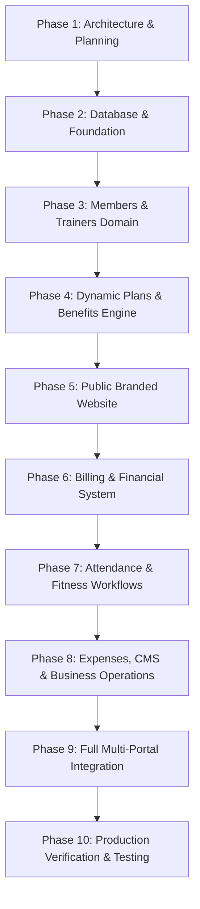

# RV FITNESS — Phased Implementation Plan

**Facility:** RV Fitness, Narsobawadi, Maharashtra, India  
**Scope:** Complete Production-Ready Gym Management Platform  
**Target:** 10 Sequential Phases with Measurable Acceptance Criteria  

---

## Phase Breakdown

---

### Phase 1: Requirements & Architecture Design
- **Deliverables:** `PROJECT_ARCHITECTURE.md`, `DATABASE_SCHEMA.md`, `API_CONTRACT.md`, `DESIGN_SYSTEM.md`, `IMPLEMENTATION_PLAN.md`, `.env.example`.
- **Acceptance Criteria:** All documentation created, reviewed, and aligned with RV Fitness brand identity and MySQL database requirements.

### Phase 2: Database Schema & Core Foundation
- **Deliverables:**
  - Complete `schema.prisma` covering all 24 models and enums.
  - Apply migrations to MySQL database (`rvfitness_dev`).
  - Seed admin, sample trainers, members, plans, and benefits.
  - Setup unified JWT authentication, password hashing, and role middleware (`ADMIN`, `TRAINER`, `MEMBER`).
- **Acceptance Criteria:** `npx prisma db push` executes with zero errors; all foreign keys, unique constraints, and indexes active in MySQL InnoDB engine.

### Phase 3: Members & Trainers Management
- **Deliverables:**
  - Backend modules: `src/modules/members/` and `src/modules/trainers/`.
  - Admin views: `MemberDirectory`, `AddMemberModal`, `TrainerDirectory`, `AssignTrainerModal`.
  - Member unique code generation (`RV-2026-XXXX`).
  - Trainer specialties and public bio configuration.
- **Acceptance Criteria:** Admin can create, edit, search members; assign members to trainers; verify role constraints.

### Phase 4: Dynamic Plans & Benefits Engine
- **Deliverables:**
  - Backend modules: `src/modules/plans/` and `src/modules/benefits/`.
  - Plan management UI: Add/edit plans (Monthly, 6-Month, Yearly, Custom).
  - Dynamic reorderable benefit assignment.
  - **Historical price protection:** Plan snapshotting upon enrollment.
  - Membership lifecycle: Assign, Activate, Renew, Freeze with date extension.
  - Expiry alert calculation (30, 15, 7, 3 days).
- **Acceptance Criteria:** Modifying plan price from ₹1,500 to ₹1,800 does not alter existing invoices or active membership terms.

### Phase 5: Cinematic Public Brand Website
- **Deliverables:**
  - Public navigation header with RV Fitness logo, menu links, and login shortcut.
  - Hero section with headline *"BUILD YOUR STRENGTH. DEFINE YOURSELF."* and gym photography.
  - Four Forces of Progress interactive section (*Discipline, Power, Recovery, Mindset*).
  - Dynamic Memberships section reading real published plans from MySQL.
  - Equipment & Facilities showcase.
  - Certified Trainers grid with specialties and ratings.
  - Events, Gallery & Offers public pages.
  - Working Contact & Location form with Narsobawadi details and working hours.
- **Acceptance Criteria:** Changing plan pricing in Admin instantly reflects on `/memberships` without hardcoded frontend arrays.

### Phase 6: Billing, Payments & Receipts System
- **Deliverables:**
  - Invoices management: Tax invoices, line-item pricing, GST breakdown, status machine (`DRAFT` $\rightarrow$ `ISSUED` $\rightarrow$ `PAID`).
  - Offline/digital payments recording (Cash, UPI, Card, Bank).
  - GST Receipt generation and streaming PDFKit downloads (`/receipts/:id/pdf`).
  - Refund management with two-step approval workflow.
- **Acceptance Criteria:** All financial operations execute in MySQL transactions with BigInt paisa precision; 0 floating-point rounding errors.

### Phase 7: Attendance & Fitness Workflows
- **Deliverables:**
  - Attendance check-in desk for Admin/Trainer.
  - Member rotating HMAC QR token generator in Member Portal.
  - QR scanner validation and duplicate check-in prevention.
  - Fitness assessment logger (Weight, Height, calculated BMI, Chest, Waist, Arms).
  - Workout plan creator with daily split and exercises.
  - Nutrition diet plan creator with daily calories and macros.
  - Member Portal views for QR ID, workouts, diets, and body progress charts.
- **Acceptance Criteria:** Member scans QR code at front desk; check-in is logged with timestamp; duplicates on the same calendar day are prevented.

### Phase 8: Expenses, CMS & Business Operations
- **Deliverables:**
  - Expense management module (Rent, Electricity, Maintenance, Salaries).
  - Income statement / P&L reporting (Collections vs. Expenses vs. Net Result).
  - Targeted in-app notifications engine (`ALL`, `EXPIRING`, `UNPAID`, `TRAINER_MEMBERS`).
  - CMS management: Events, Photo Gallery, Offers & Coupons, Contact inquiries.
  - Daily collection register closing & cash drawer discrepancy check.
  - Bank and physical ledger reconciliation audits.
- **Acceptance Criteria:** Recording an expense updates the net operating result; broadcasting a notification targets only eligible member accounts.

### Phase 9: Multi-Portal Integration & Polish
- **Deliverables:**
  - Unify all 24 Admin modules into clean, grouped navigation.
  - Refine Trainer Workspace (`/trainer/*`) for assigned members and fitness logging.
  - Refine Member Self-Service Portal (`/portal/*`) for QR ID, active plans, workouts, and invoices.
  - Polish transitions, error toasts, empty states, and loading skeletons.
- **Acceptance Criteria:** Zero dead buttons; zero dummy forms; consistent `#080808` / `#FFC21A` theme throughout.

### Phase 10: Production Verification & Testing
- **Deliverables:**
  - Run full automated test suite with Vitest.
  - Run production frontend build (`npm run build`).
  - Verify database backup & restore scripts.
  - Generate final `IMPLEMENTATION_REPORT.md`.
- **Acceptance Criteria:** 100% of unit and integration tests pass; frontend builds with 0 errors; clean working tree.
