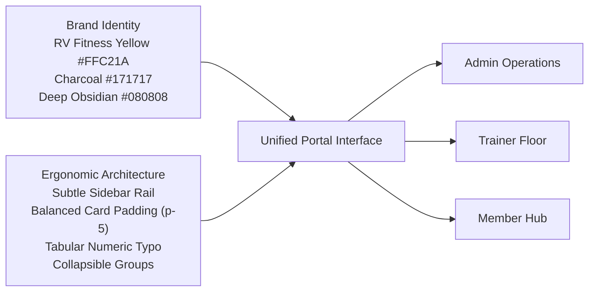

# RV Fitness — Portal Design System Specification

**Document Version:** 1.0.0  
**Date:** October 15, 2026  
**Audience:** UI/UX Designers, Frontend Engineers, Full-Stack Developers  
**Scope:** Admin Portal, Trainer Command Center, Member Self-Service Portal

---

## 1. Design Philosophy: Restrained Professional Fitness Application

While consumer landing pages benefit from cinematic, high-contrast visual drama, **operational business software requires clarity, scannability, and ergonomic reading comfort**.

Gym receptionists, accountants, trainers, and athletes use these portals multiple times per day under varied ambient lighting conditions. The RV Fitness Portal Design System blends the established brand palette (Yellow `#FFC21A` and Charcoal `#171717`) with **restrained, readable surfaces, crisp section boundaries, and balanced information density**.



---

## 2. Color Tokens & Surface Hierarchy

| Token Name | Hex Value | Role & Usage |
|---|---|---|
| **Brand Primary Accent** | `#FFC21A` | Key CTA buttons, active state indicators, key metrics, brand logo accents |
| **Brand Accent Hover** | `#E0A816` | Interactive hover state for primary yellow elements |
| **Brand Accent Subtle** | `rgba(255, 194, 26, 0.12)` | Subtle badge backgrounds, table row hover highlights |
| **Deep Application Base** | `#080808` | Top header, application outer container, modal backdrops |
| **Sidebar & Nav Surface** | `#111114` | Navigation drawer, left rail, footer dividers |
| **Card / Section Surface** | `#16161B` | High-clarity elevated cards, data panels, operational containers |
| **Inner Well / Input Well** | `#1C1C24` | Form inputs, select dropdowns, search inputs, nested card wells |
| **Border Subtle** | `rgba(255, 255, 255, 0.08)` | Default card borders, structural table dividers |
| **Border Active / Focused** | `rgba(255, 194, 26, 0.45)` | Input focus rings, selected rows, active tabs |
| **Text Primary** | `#FFFFFF` / `#F5F4F0` | Headings, card titles, primary values, active links |
| **Text Secondary** | `#D4D4D8` / `#A1A1AA` | Form labels, table data, descriptive text, breadcrumbs |
| **Text Muted** | `#71717A` / `#777777` | Timestamps, helper notes, inactive group titles |
| **Success State** | `#10B981` | Paid status, turnstile inside gym, positive delta |
| **Warning State** | `#F59E0B` | Expiring memberships, partial payments, attention notes |
| **Danger State** | `#EF4444` | Overdue invoices, failed scans, canceled plans |
| **Info / Digital State** | `#3B82F6` | UPI payments, system notices, draft statuses |

---

## 3. Typography Scale & Numerical Formatting

### Font Families
- **Primary Typography:** `Inter, -apple-system, BlinkMacSystemFont, 'Segoe UI', Roboto, sans-serif`
- **Numerical & Financial Data:** `'JetBrains Mono', 'Fira Code', ui-monospace, SFMono-Regular, monospace` with `tabular-nums`

### Scale & Weight Rules
- **Page Titles:** `text-xl sm:text-2xl font-black uppercase tracking-tight text-white`
- **Section Headers:** `text-sm sm:text-base font-bold uppercase tracking-wide text-white`
- **Metric Figures (De-congested):**
  - Old (Distorted): `text-4xl sm:text-5xl font-black` *(Takes up 100px+ height)*
  - New (Standardized): `text-2xl sm:text-3xl font-bold font-mono tabular-nums text-white`
- **Data Labels:** `text-[11px] font-mono uppercase font-bold tracking-wider text-[#A1A1AA]`
- **Table Cell Data:** `text-xs sm:text-sm font-medium text-[#D4D4D8]`
- **Timestamps & Codes:** `text-xs font-mono text-[#A1A1AA]`

---

## 4. Navigation Architecture & Categorization

The sidebar navigation is structured into **5 logical operational groups**, eliminating continuous scrolling and visual fatigue:

```
├── OVERVIEW
│   └── Dashboard (/dashboard)
│
├── GYM OPERATIONS
│   ├── Members (/admin/members)
│   ├── Attendance / Turnstile Desk (/admin/attendance)
│   ├── Memberships & Renewals (/admin/memberships)
│   ├── Plans & Benefits (/admin/plans)
│   └── Trainers & Staff (/admin/trainers)
│
├── FINANCE
│   ├── Invoices (/invoices)
│   ├── Payments (/payments)
│   ├── Receipts (/receipts)
│   ├── Outstanding Balances (/outstanding)
│   ├── Expenses (/admin/expenses)
│   ├── Refunds (/refunds)
│   ├── Reconciliation (/reconciliation)
│   ├── Daily Closing (/daily-closing)
│   └── Financial Reports (/reports)
│
├── WEBSITE & COMMUNICATION
│   ├── Website Content (/admin/cms?tab=content)
│   ├── Offers & Coupons (/admin/cms?tab=offers)
│   ├── Events & Challenges (/admin/cms?tab=events)
│   ├── Gallery Media (/admin/cms?tab=gallery)
│   ├── Inquiries (/admin/cms?tab=inquiries)
│   └── Announcements (/admin/notifications)
│
└── ADMINISTRATION
    ├── Audit History (/audit)
    └── System Settings (/settings)
```

### Collapsible Accordion Rules
- Group headers display a compact uppercase label with an expand/collapse chevron.
- The active route's parent group is **automatically expanded** on page load.
- Users can collapse non-relevant groups to keep their current workflow focused.
- On desktop, an icon-rail collapse mode provides maximum workspace width.
- On mobile, a lightweight slide-over drawer with backdrop-blur handles touch navigation.

---

## 5. Component Geometry & Spacing Standards

### Card Standards
- **Outer Radius:** `rounded-2xl` (16px)
- **Inner Padding:** `p-5 sm:p-6` (replaces bloated 32px padding)
- **Elevation:** Subtle shadow (`shadow-lg shadow-black/40`), `border border-white/10`
- **Zebra Tables:** Alternating rows with subtle contrast (`bg-[#16161B]` and `bg-[#131317]`), hover highlight `hover:bg-[#1C1C24]`.

### Form Controls
- **Input Height:** `h-11` (44px) for desktop and mobile touch compliance.
- **Background:** `bg-[#1C1C24]` with `border-white/10` and `focus:border-[#FFC21A]`.
- **Labels:** Positioned consistently above the control with required asterisk in `#FFC21A`.

### Action Buttons
- **Primary:** `bg-[#FFC21A] text-[#080808] font-bold text-xs uppercase hover:bg-[#E0A816] rounded-xl px-4 py-2.5`
- **Secondary:** `bg-[#1C1C24] text-white border border-white/10 hover:border-[#FFC21A]/50 rounded-xl px-4 py-2.5`
- **Destructive:** `bg-rose-500/10 text-rose-400 border border-rose-500/20 hover:bg-rose-500/20 rounded-xl px-4 py-2.5`

---

## 6. Accessibility & Motion Guidelines

- **Contrast Guarantee:** High-contrast text exceeds WCAG AA 4.5:1 ratio across all forms and tables.
- **Tabular Alignment:** Numbers are always right-aligned in tables with uniform mono spacing.
- **Motion Restraint:** Operational transitions use micro-animations (150ms-200ms opacity and translate) without spring jitter.
- **Prefers-Reduced-Motion:** Animations automatically degrade to instantaneous cuts when reduced motion is requested.
