# RV FITNESS — Complete Platform Architecture

**Facility:** RV Fitness, Narsobawadi, Maharashtra, India  
**System:** Complete Production-Ready Gym Management Platform  
**Architecture Style:** Modular Monolith (Single Backend, Shared MySQL Database, Multi-Portal Frontend)  
**Version:** 2.0.0-PROD  

---

## 1. System Overview

RV Fitness is an end-to-end commercial gym management platform tailored specifically for the RV Fitness facility located in Narsobawadi, Taluka Shirol, Kolhapur district, Maharashtra. The application serves four distinct audiences through a unified full-stack architecture:

1. **Public Visitors & Prospects:** Cinematic, high-performance public website showcasing the facility, training philosophy, equipment, certified trainers, and real published membership plans with direct enrollment.
2. **Gym Administration (`ADMIN`):** Complete operational control spanning 24 management modules: member lifecycle, trainer assignments, dynamic plan & benefit pricing, attendance tracking, invoices, offline/digital collection accounting, refunds, expense tracking, P&L reporting, shift closings, and website CMS.
3. **Fitness Trainers (`TRAINER`):** Dedicated portal to manage assigned members, log fitness assessments, build structured workout & diet plans, monitor member progress, and track personal attendance without accessing billing or private financial data.
4. **Gym Members (`MEMBER`):** Self-service member portal with digital gym ID card, secure QR-code check-in token, active membership status, upcoming renewal warnings, workout & nutrition plans, body measurement history, and direct invoice/receipt PDF downloads.

```mermaid
graph TD
    subgraph Clients["Unified Client Layer (React 18 + TypeScript + Vite)"]
        PublicWeb["Public Brand Website<br/>/ (Home, About, Plans, Facilities, Trainers, Contact)"]
        AdminPortal["Admin Management Portal (24 Modules)<br/>/admin/* (Operations, Billing, Plans, Attendance, CMS)"]
        TrainerPortal["Trainer Workspace<br/>/trainer/* (Assigned Members, Workouts, Diets)"]
        MemberPortal["Member Self-Service<br/>/portal/* (QR Check-in, Plans, Invoices, Receipts)"]
    end

    subgraph API["Unified REST API Gateway (Node.js + Express + TypeScript)"]
        AuthMid["Auth & RBAC Middleware<br/>(JWT + Role Enforcement)"]
        RateLimit["Rate Limiting & Security Headers<br/>(Helmet + Express Rate Limit)"]
        ValMid["Request Validation<br/>(Zod Schemas)"]
        Controllers["Domain Controllers"]
    end

    subgraph CoreServices["Domain Services (Modular Monolith)"]
        AuthSvc["Auth & Users"]
        MemberSvc["Members & Trainers"]
        PlanSvc["Plans & Benefits Engine"]
        MemberShipSvc["Membership Lifecycle"]
        AttendSvc["Attendance & QR Engine"]
        BillingSvc["Billing, Payments & Receipts"]
        ExpenseSvc["Expenses & Financial Engine"]
        FitnessSvc["Workouts, Diets & Progress"]
        NotifSvc["Targeted Notifications"]
        CmsSvc["Website CMS & Settings"]
        AuditSvc["Immutable Audit Logger"]
    end

    subgraph DataLayer["Authoritative Data Layer"]
        PrismaORM["Prisma ORM (Versioned Migrations)"]
        MySQL[("MySQL 8.0 (InnoDB Engine)<br/>ACID Transactions | BigInt Paisa Precision")]
    end

    Clients -->|HTTPS / REST API| RateLimit
    RateLimit --> AuthMid
    AuthMid --> ValMid
    ValMid --> Controllers
    Controllers --> CoreServices
    CoreServices --> PrismaORM
    PrismaORM --> MySQL
```



---

## 2. Technology Stack & Runtime Dependencies

| Layer | Technology | Version | Rationale & Trade-offs |
| :--- | :--- | :--- | :--- |
| **Frontend Framework** | React + TypeScript | 18.3.x | Component-based UI, strong static typing, predictable rendering |
| **Build & Tooling** | Vite | 6.x | Instant Hot Module Replacement (HMR), optimized Rollup production bundles |
| **Styling & Design** | Tailwind CSS | 4.x | Utility-first with customized RV Fitness brand tokens (`#080808`, `#FFC21A`) |
| **Motion & Animation** | Framer Motion / Motion | 12.x | Hardware-accelerated, spring-physics page reveals and SVG transitions |
| **Client State & Cache**| TanStack React Query + Zustand | 5.x / 5.x | Server-state caching, automatic invalidation, and lightweight global auth |
| **Backend Runtime** | Node.js | 20+ LTS | Asynchronous non-blocking I/O, native ESM support, cross-platform stability |
| **API Framework** | Express | 4.21.x | Robust, minimal, battle-tested HTTP routing with modular architecture |
| **Database** | MySQL 8.0+ / MariaDB 10.4+ | 8.0.36 | InnoDB ACID compliance, strict constraints, row-level locking, foreign keys |
| **Database Access** | Prisma ORM | 5.22.x | Type-safe queries, migration history, atomic `$transaction` orchestration |
| **Request Validation** | Zod | 3.23.x | Zero-dependency TypeScript-first validation for body, query, and params |
| **Authentication** | JWT (`jsonwebtoken`) + `bcryptjs` | 9.x / 2.4.x | Secure password hashing (work factor 12) and stateless signed session tokens |
| **PDF Generation** | PDFKit | 0.15.x | Programmatic vector PDF stream generation for official invoices and receipts |
| **QR Code Engine** | `qrcode` | 1.5.x | Server-side cryptographic token-to-matrix rendering for contactless check-ins |
| **Structured Logging** | Winston + Morgan | 3.17.x | Leveled logging, daily rotation, sanitized output preventing credential leaks |
| **Testing** | Vitest | 2.1.x | Unit and integration test runner with isolated transactions and coverage |

---

## 3. Modular Monolith Architecture

The backend and frontend are organized into isolated domain modules sharing a unified data store and authentication context:

```
i:/Antigravity/RV_Fitness/
├── backend/
│   ├── prisma/
│   │   ├── schema.prisma              # Comprehensive MySQL Schema
│   │   ├── migrations/                # Versioned SQL migrations
│   ├── src/
│   │   ├── config/                    # Environment, database, logger config
│   │   ├── middleware/                # Auth, RBAC, Zod validation, error handler
│   │   ├── shared/                    # Financial math (Paisa), number generators, errors
│   │   ├── modules/
│   │   │   ├── auth/                  # Login, registration, token refresh, password reset
│   │   │   ├── users/                 # User credentials and role management
│   │   │   ├── members/               # Member profiles, emergency contacts, photos
│   │   │   ├── trainers/              # Trainer profiles, specialties, member assignments
│   │   │   ├── plans/                 # Membership plans & dynamic benefits engine
│   │   │   ├── memberships/           # Lifecycle: assign, renew, freeze, expire
│   │   │   ├── attendance/            # QR generation, scanner validation, history
│   │   │   ├── fitness/               # Assessments, BMI, workouts, diets, goal tracking
│   │   │   ├── billing/               # Invoices, items, price snapshots
│   │   │   ├── payments/              # Payment records, allocations, reversals
│   │   │   ├── receipts/              # Official GST receipts & PDFKit streams
│   │   │   ├── refunds/               # Two-step refund request & disburse engine
│   │   │   ├── expenses/              # Operating expenses (rent, electricity, salaries)
│   │   │   ├── reports/               # P&L, collection channels, attendance, aging
│   │   │   ├── closing/               # Daily shift register closing & discrepancy check
│   │   │   ├── reconciliation/        # Bank & cash ledger vs. statement audit
│   │   │   ├── notifications/         # Targeted in-app alerts (all, expiring, unpaid)
│   │   │   ├── cms/                   # Website events, gallery, offers, contact queries
│   │   │   ├── audit/                 # Immutable append-only audit trail
│   │   │   └── settings/              # Gym profile, prefixes, tax rates, warning days
│   │   ├── app.ts                     # Express application configuration
│   │   └── server.ts                  # HTTP listener & database connection
├── frontend/
│   ├── src/
│   │   ├── components/
│   │   │   ├── layout/                # Sidebar, Header, PublicNavbar, Footer, Layouts
│   │   │   └── ui/                    # Button, Card, Input, Table, Modal, Badges, Tabs
│   │   ├── features/
│   │   │   ├── public/                # Home, About, Plans, Facilities, Trainers, Contact
│   │   │   ├── auth/                  # LoginPage, RegisterPage, ForgotPasswordPage
│   │   │   ├── admin/                 # 24 operational management views
│   │   │   ├── trainer/               # Trainer dashboard, assigned members, plan builders
│   │   │   ├── member/                # Member dashboard, digital QR ID, workouts, receipts
│   │   │   └── billing/               # Shared invoices, payments, and financial tables
│   │   ├── hooks/                     # TanStack Query API hooks
│   │   ├── lib/                       # API client, formatters, financial utilities
│   │   ├── stores/                    # Zustand auth and UI stores
│   │   ├── types/                     # Shared TypeScript interfaces
│   │   ├── index.css                  # RV Fitness Tailwind v4 theme tokens
│   │   ├── App.tsx                    # Query provider, router, global toaster
│   │   └── Router.tsx                 # Route hierarchy with role-based guards
```

---

## 4. Role-Based Access Control (RBAC) Matrix

| Domain / Action | Public Visitor | `MEMBER` | `TRAINER` | `ADMIN` |
| :--- | :---: | :---: | :---: | :---: |
| **Browse Public Website & Published Plans** | ✅ | ✅ | ✅ | ✅ |
| **Submit Contact Inquiry / Membership Lead** | ✅ | ✅ | ✅ | ✅ |
| **Register for Member Account** | ✅ | ❌ | ❌ | ❌ |
| **View Own Profile, Digital ID & QR Code** | ❌ | ✅ (Own) | ❌ | ✅ |
| **View Own Workouts, Diets & Body Stats** | ❌ | ✅ (Own) | ❌ | ✅ |
| **View Own Invoices, Receipts & Payments** | ❌ | ✅ (Own) | ❌ | ✅ |
| **Scan / Record Member Attendance** | ❌ | ❌ | ✅ (Assigned) | ✅ (All) |
| **Create & Update Workouts and Diets** | ❌ | ❌ | ✅ (Assigned) | ✅ (All) |
| **Log Member Fitness Assessments & Goals** | ❌ | ❌ | ✅ (Assigned) | ✅ (All) |
| **Manage Membership Plans, Prices & Benefits** | ❌ | ❌ | ❌ | ✅ |
| **Issue Invoices, Collect Dues & Reverse** | ❌ | ❌ | ❌ | ✅ |
| **Approve & Process Cash/Digital Refunds** | ❌ | ❌ | ❌ | ✅ |
| **Record Operating Expenses & Shift Closings** | ❌ | ❌ | ❌ | ✅ |
| **Access Financial Reports & P&L Analysis** | ❌ | ❌ | ❌ | ✅ |
| **Manage Website CMS, Events & Gallery** | ❌ | ❌ | ❌ | ✅ |
| **Configure System Settings & Audit Logs** | ❌ | ❌ | ❌ | ✅ |

---

## 5. Route Architecture

### Public Routes
- `/` — Cinematic RV Fitness Homepage (Hero, Four Forces, Plans preview, Trainers, Equipment, Location)
- `/about` — Gym story, philosophy, training standards, and facility overview
- `/memberships` — Real-time published plans fetched from MySQL with dynamic benefits & checkout
- `/facilities` — Equipment zones, cardio theater, heavy lifting platform, lockers, steam
- `/trainers` — Certified trainer profiles, credentials, and specialties
- `/events` — Upcoming gym competitions, bootcamps, and workshops
- `/gallery` — Facility photography, member transformations, and community events
- `/offers` — Active promotional deals and coupon codes
- `/contact` — Narsobawadi location map, contact information, working hours, inquiry form
- `/login` — Unified sign-in with automatic role-based redirect
- `/register` — Public member registration (assigns strictly `MEMBER` role)

### Admin Portal Routes (`/admin/*`)
- `/admin/dashboard` — Executive operations command center
- `/admin/members` — Member directory, registration, code generation, profile editor
- `/admin/trainers` — Trainer directory, invitations, member assignments
- `/admin/plans` — Plan builder, INR pricing, reorderable benefits, promotional tags
- `/admin/memberships` — Active memberships, renewals, freeze/unfreeze controls, cancellations
- `/admin/invoices` — Tax invoices, line-item pricing, GST breakdown, status management
- `/admin/payments` — Payment ledger, front-desk collection form, UTR validation
- `/admin/receipts` — Official GST receipts repository with PDFKit downloads
- `/admin/refunds` — Two-step refund request, approval, and disbursement tracking
- `/admin/attendance` — Live daily check-in desk, QR scanner validation, peak-hour analytics
- `/admin/workouts` — Global workout plan directory and exercise library
- `/admin/diets` — Global nutrition plan directory and calorie/macro guidelines
- `/admin/progress` — Member body measurement logs and assessment history
- `/admin/events` — Event publisher, schedule dates, registration management
- `/admin/gallery` — Photo gallery CMS with category filters
- `/admin/offers` — Promotional discount coupons and validity rules
- `/admin/notifications` — Targeted broadcast notifications (All, Expiring, Unpaid)
- `/admin/expenses` — Operational expense log (Rent, Electricity, Maintenance, Salaries)
- `/admin/reports/financial` — Revenue vs. Expense P&L reports, channel shares, plan yields
- `/admin/reports/attendance` — Member visit frequencies, inactive member warnings
- `/admin/reconciliation` — Bank statement & physical cash variance audit
- `/admin/daily-closing` — End-of-shift register drawer closing and reconciliation
- `/admin/audit` — Tamper-evident chronological audit trail
- `/admin/users` — Staff account provisioning and role overrides
- `/admin/settings` — Gym legal metadata, GSTIN, prefixes, grace periods, opening hours

### Trainer Workspace Routes (`/trainer/*`)
- `/trainer/dashboard` — Trainer schedule, assigned members count, attendance status
- `/trainer/members` — Assigned members directory with fitness summaries
- `/trainer/members/:id` — Member fitness detail, measurement history, assessment logger
- `/trainer/workouts` — Custom workout routine creator and assigned plan viewer
- `/trainer/diets` — Meal plan creator with macro targets
- `/trainer/attendance` — Member class check-in and trainer shift logs

### Member Portal Routes (`/portal/*`)
- `/portal/dashboard` — Member home: membership card, remaining days, assigned trainer
- `/portal/qr-id` — High-security rotating QR code token for contactless turnstile/desk check-in
- `/portal/memberships` — Active subscription details, included benefits, renewal request
- `/portal/workouts` — Assigned workout routine with daily exercise breakdown
- `/portal/diet` — Assigned meal plan with calorie and macro targets
- `/portal/progress` — Measurement history, weight tracking, and BMI trend chart
- `/portal/invoices` — Personal invoice history and balance status
- `/portal/receipts` — Downloadable official payment receipts
- `/portal/notifications` — Gym announcements, expiry warnings, and direct notices

---

## 6. Financial Integrity & Snapshot Architecture

1. **Integer Minor-Unit Math (Paisa):**
   - Authoritative monetary values are stored as `BigInt` (paisa, where ₹1.00 = 100 paisa) to eliminate IEEE 754 floating-point rounding anomalies.
2. **Historical Price Protection:**
   - When an invoice or membership is created, the system **snapshots** the agreed plan name, unit price, tax rate, discount, and included benefits into the record. Subsequent price updates to a plan will **never** alter historical invoices or active membership contracts.
3. **Database Transactions (`$transaction`):**
   - All multi-table mutations (Invoice creation + line items, Payment confirmation + allocation + receipt generation + invoice paid amount update, Refund processing + invoice balance restore) execute inside atomic database transactions.
4. **Idempotency & Concurrency:**
   - Offline payment recording enforces unique idempotency keys to prevent double-submitting receipts under slow network conditions.

---

## 7. Security Architecture

- **Server-Enforced RBAC:** Role authorization middleware on all protected API routes; client route guards are treated purely as UX routing helpers.
- **Strict Role Elevation Protection:** Public registration endpoints are hardcoded to assign `UserRole.MEMBER`. Privileged roles (`ADMIN`, `TRAINER`) can only be provisioned by authenticated administrators or via seed scripts.
- **Revocable QR Tokens:** Attendance QR codes do not embed raw member PII. They carry a cryptographic, short-lived, single-use token verified against the backend attendance engine.
- **Audit Logging:** Every administrative write operation creates an immutable audit entry recording `userId`, `action`, `entityType`, `entityId`, `oldValues`, `newValues`, `ipAddress`, and `userAgent`.
